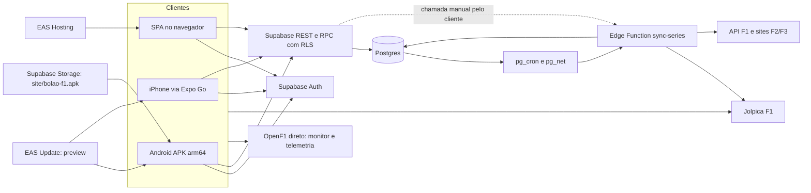
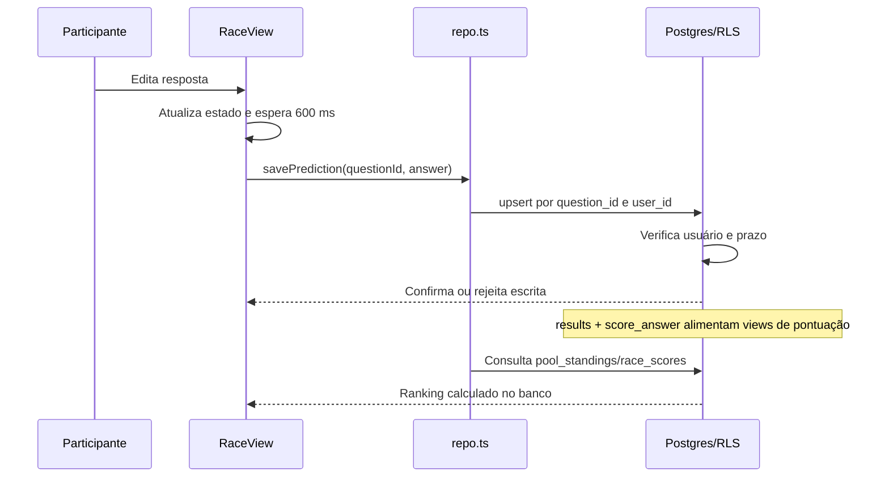

# Arquitetura e integrações

## Visão de execução

A seta dos clientes para Jolpica representa importação sob demanda e consulta manual de pódio. Não existe servidor Node próprio, API REST própria separada, contêiner ou infraestrutura AWS declarada no repositório. O backend gerenciado é Supabase; scripts Node são ferramentas operacionais. O endpoint HTTP da função é o único serviço de aplicação próprio no servidor.

## Stack e organização

Versões declaradas: Expo `~57.0.24`, React Native `0.86.3`, React `19.2.3`, TypeScript `~6.0.3`, Supabase JS `^2.109.0`. Resoluções exatas estão em `package-lock.json`. Expo Router parte de `expo-router/entry`; aliases `@/*` apontam para `src/*`. TypeScript é estrito, mas há uso de `any` e coerções de resultados do banco; os tipos não são gerados do schema.

| Diretório/arquivo | Responsabilidade |
|---|---|
| `src/app/` | Telas e navegação baseada em arquivos |
| `src/components/` | Formulários, pódio, calendário, quadro de palpites e gráficos de perfis |
| `src/lib/repo.ts` | Principal camada de consultas, comandos, RPCs e importação no cliente |
| `src/lib/types.ts` | Contratos manuais de produto e respostas SQL |
| `src/lib/supabase.ts`, `auth.tsx` | Cliente Supabase, armazenamento e estado da sessão |
| `src/lib/useSeason.tsx`, `useYear.ts`, `usePool.tsx` | Carregamento do ano atual, de um ano/categoria e do bolão |
| `src/lib/f1api.ts` | Adaptador Jolpica e fotos OpenF1 |
| `src/lib/openf1.ts`, `useLive.ts` | Adaptador e composição do monitor ao vivo |
| `src/lib/format.ts`, `nav.ts`, `invite.ts` | Brasília, navegação para perfis e compartilhamento |
| `src/ui/` | Tema e componentes básicos |
| `supabase/migrations/` | Modelo, permissões, triggers, views e regras SQL |
| `supabase/functions/` | Deno: função de sincronização e adaptadores compartilhados |
| `scripts/` | SQL administrativo, migrations, importação e upload do APK |
| `site/entrar.html` | Página pública de convite independente da SPA |
| `plugins/withArm64Only.js` | Restringe arquiteturas Android no prebuild |
| `.github/workflows/` | CI e publicação |

`dist`, `.expo`, `node_modules`, `android` e `ios` são gerados/ignorados. A presença local de `.aws`, `.agents` e `.codex` não constitui configuração de implantação do produto; não há arquivos de infraestrutura nesses diretórios neste checkout.

## Estado, sessão e consistência

O layout raiz monta `AuthProvider` → `SeasonProvider` → Stack e aciona atualização OTA. A sessão persiste em AsyncStorage, com renovação automática e `detectSessionInUrl: false`. Os redirecionamentos de login estão na entrada, convite e perfis de piloto/equipe; não há guard central protegendo todas as rotas. A proteção dos dados depende das políticas do banco.

Após login, `SeasonProvider` busca corridas/pilotos F1 do ano do aparelho. Se não há calendário, importa da API. `useYear` carrega calendário, pilotos e campeonatos para um ano/categoria; importa F1 se faltam corridas ou classificação. `PoolProvider` utiliza o calendário global atual e filtra GP único. Isso limita a navegação correta de bolões de anos anteriores, mesmo que o banco os conserve.

O estado fica em React Context, state e refs. Não há Redux, cache persistente de dados esportivos, fila offline nem assinatura Supabase Realtime. Telas de bolão recarregam ao receber foco; Ao vivo usa polling HTTP. Alguns erros são exibidos por Alert; outros são silenciados para manter o estado anterior, e alguns carregamentos não têm tratamento de rejeição.

O layout de bolão agora exige sessão antes de consultar o bolão e apresenta estado de indisponibilidade quando ele foi excluído, houve falha ou o usuário não tem acesso. A tela administrativa também verifica proprietário antes de carregar o formulário. O ranking geral usa RPC SQL autenticada e atualização periódica de 30 s apenas em foco/primeiro plano, com atualização manual e tratamento de erro. Sua consulta agrega bolões além das associações do chamador, sem ampliar a leitura das tabelas de palpites.

## Fluxo de palpite e ranking

A fonte do ranking é SQL, mas há cálculo de pontos por resposta no `PicksBoard` e marcações no `Podium`. Toda alteração de pontuação deve revisar esses locais para evitar discrepâncias visuais.

## Sincronização no servidor

`sync-series` recebe `{ series?: 'f1'|'f2'|'f3'|'all', season?: number }`; ausência de corpo usa todas as categorias e ano atual do servidor. Usa `SUPABASE_URL` e `SUPABASE_SERVICE_ROLE_KEY` do runtime, realiza upserts deduplicados e grava `f1_sync`. Categorias rodam sequencialmente; cada uma tem captura independente de erro. Ao incluir F1, chama `auto_settle_podiums` depois das tentativas.

Não é uma transação única entre tabelas: uma falha pode deixar parte dos dados atualizada. O handler compartilhado valida método/corpo, responde OPTIONS/CORS e propaga falhas por categoria e na apuração; só apura após sucesso F1. O cliente inspeciona o corpo e apresenta erros. JWT está habilitado na versão publicada; não há trava global de concorrência. O cron aguarda até 120 s (`0018`).

## Fontes e adaptadores

| Fonte | Uso e estratégia implementada |
|---|---|
| `api.jolpi.ca/ergast/f1` | Temporadas F1, pilotos, resultados e campeonatos; paginação de 100; fila com intervalo de 350 ms e tentativas em 429 |
| `api.formula1.com` | Classificação F2/F3, com identificadores de acesso embutidos usados pelos sites públicos |
| `fiaformula2.com`, `fiaformula3.com` | Extração de pilotos/equipes, JSON-LD de horários e tabela parcial da feature; depende do HTML das fontes |
| `api.openf1.org` | Sessão, classificação, voltas, pneus, clima, controle de prova, telemetria e fotos; fila com 400 ms entre chamadas |

Os intervalos e comentários de limites descrevem a implementação, não garantem cotas atuais dos provedores. Resultados F1 importados são da corrida principal; horários de sprint existem, mas a importação não traz os resultados de sprint. F2/F3 usa estimativas: vitórias por pontuações de 25 e última rodada baseada na data dos eventos. O histórico depende das temporadas carregadas no banco.

As siglas de pilotos antigos são geradas por temporada; `driver_id` mantém identidade entre anos. O adaptador usa um `codeBook` global mutável, portanto importações concorrentes de anos diferentes no mesmo runtime merecem atenção. A cópia `supabase/functions/_shared/f1api.ts` é idêntica à de `src/lib` no levantamento e deve continuar sincronizada. F2/F3 também tem lógica duplicada no script de operação.

## Monitor ao vivo

`src/lib/features.ts` define `LIVE_ENABLED` a partir de `EXPO_PUBLIC_LIVE_ENABLED === 'true'`, desabilitado por padrão. A rota Ao vivo mostra aviso de assinatura sem montar `LiveMonitor`; `useLive` e o adaptador também fazem bloqueio preventivo. Desabilitado, não há autenticação/settings, timers ou consultas de sessão/telemetria do monitor. O importador de fotos continua independente. Alterar a flag requer novo bundle. Os parágrafos seguintes descrevem o modo habilitado.

`useLive` considera a sessão ativa da meia hora anterior à meia hora posterior aos horários publicados. Carrega a sessão mais recente, mantém resultados/voltas em memória e consulta a cada 8 s com acesso autenticado ou 15 s sem ele. Fora da sessão usa o resultado final. Não há WebSocket. A fila de requisições pode fazer um ciclo durar mais que o intervalo, sem trava contra sobreposição.

Credenciais opcionais `openf1_user` e `openf1_pass` são lidas de `app_settings` pelo cliente e trocadas por token no provedor. O token fica em memória; tentativas são espaçadas por dez minutos, e um 401 limpa o token. Essas credenciais **não são secretas para os usuários autenticados** na arquitetura atual. Ver [diagnóstico](DIAGNOSTICO.md).
