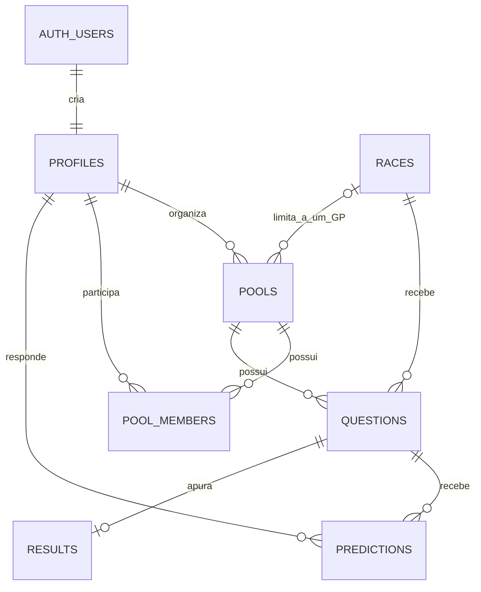

# Dados, regras SQL e permissões

Schema versionado e aplicado até `0019` no Supabase compartilhado em 16/10/2026. O histórico é mantido em `public._migrations`; veja [validação de produção](VALIDACAO_PRODUCAO.md).

## Modelo relacional



Tabelas esportivas se associam principalmente por chaves lógicas; não há FK entre resultados oficiais, pilotos e corridas. Siglas em JSON também não têm integridade referencial.

| Tabela | Identidade e finalidade |
|---|---|
| `profiles` | PK `id`, FK para `auth.users`; nome, avatar, criação |
| `pools` | UUID, nome, código único, dono, temporada, texto de aposta, antecedência; `race_id` opcional para GP único |
| `pool_members` | PK `(pool_id,user_id)`, data de entrada |
| `races` | UUID; unique `(series,season,round)`; nome, circuito, país, largada UTC e horários das sessões, sprint e `times_tbc` |
| `drivers` | PK `(series,season,code)`; `driver_id` estável, nome, número, equipe, cor e `headshot_url` |
| `questions` | UUID, bolão, corrida, tipo, enunciado, pontos, quase-acerto e ordenação; índice único parcial de pódio por bolão/corrida |
| `predictions` | UUID; unique `(question_id,user_id)`; `answer jsonb`, `updated_at` atualizado por trigger |
| `results` | PK/FK `question_id`; `answer jsonb`, autor opcional e `set_at`; autor nulo na apuração automática |
| `race_results` | PK `(series,season,round,session,position,driver_code)`; equipe, grid, pontos, status e volta mais rápida |
| `driver_standings` | PK `(series,season,driver_code)`; posição, equipe, pontos e vitórias |
| `constructor_standings` | PK `(series,season,team)`; posição, cor, pontos e vitórias |
| `f1_sync` | PK `(series,season)`; última rodada com resultado e momento da sincronização; apesar do nome serve às três categorias |
| `app_settings` | PK `key`, `value text`; configuração operacional legível por usuários autenticados |
| `_migrations` | Criada pelo script de setup; nome do arquivo aplicado e data; controle próprio de migrations |

`series` usa `f1`, `f2`, `f3` no código, mas as colunas SQL são texto sem enum/check correspondente. `session` é texto; tipos do cliente preveem `race`, `sprint` e `feature`. A PK dos resultados permite dois pilotos na mesma posição para corridas históricas com carro compartilhado.

## Contrato das respostas

```json
{
  "podium": { "p1": "VER", "p2": "NOR", "p3": "LEC" },
  "driver": { "driver": "RUS" },
  "position_of_driver": { "pos": 5 },
  "yesno": { "v": true },
  "text_prediction": { "t": "resposta livre" },
  "text_result": { "correct_users": ["uuid-do-participante"] }
}
```

Esse bloco ilustra os formatos; cada linha em `predictions.answer` ou `results.answer` recebe só o objeto correspondente. A função `score_answer` retorna zero sem previsão ou resultado, aplica as regras de [produto](PRODUTO.md) e depende de tipos JSON válidos. Não existe validação completa do formato, da duplicação de pilotos no pódio ou de valores negativos de pontos/antecedência no banco. A UI limita parte da entrada, mas isso não substitui constraints.

## Views e estatísticas

| View | Papel |
|---|---|
| `prediction_scores` | Junta palpite, pergunta e resultado e chama `score_answer` |
| `race_scores` | Soma por bolão, corrida e usuário |
| `pool_standings` | Inclui membros sem pontos, soma total e conta corridas apuradas com pontuação |
| `driver_results` | Resultados F1 da corrida principal associados ao `driver_id` e aos dados da corrida |
| `driver_career_totals` | Totais de carreira e títulos do piloto |
| `team_career_totals` | Totais por nome de equipe; inclui `races` (GPs distintos) e `entries` (linhas de resultados) |

Views usam `security_invoker`, sujeitas às permissões/RLS do chamador. Os agregados são calculados em consulta, sem materialized views. Há índices para membros por usuário, perguntas por bolão/corrida, palpites por usuário, pilotos por identidade e resultados por piloto/equipe.

`global_standings()` agrega `pool_standings` de todos os bolões existentes e anos. Retorna `user_id`, `name`, `avatar`, `total`, `pools_played`, `races_scored` e `rank`. Usa `security definer` com `search_path=public` para agregar além dos bolões do chamador; exige `auth.uid()` e EXECUTE apenas para `authenticated`. Não expõe respostas individuais. Exclusão em cascata de um bolão remove seus pontos da consulta imediatamente; a interface recarrega periodicamente.

`season_finished` considera concluído um ano sem corrida F1 futura no banco; calendário incompleto pode antecipar a contagem de títulos. `classified` usa status `Finished` ou começando com `+`; isso é uma aproximação para abandono/classificação. Poles são inferidas de `grid = 1`. Pontos de carreira somam resultados importados de corrida principal, enquanto os pontos do campeonato vêm da classificação oficial e podem incluir outras parcelas. Estatísticas não devem ser apresentadas como auditoria oficial independente da cobertura importada.

## RPCs e triggers

| Grupo | Funções e comportamento |
|---|---|
| Identidade e prazo | `is_member`, `is_owner`, `lock_at`, `question_is_open` |
| Bolões | `gen_invite_code`, `create_pool`, `join_pool`, `join_pool_by_id`, `my_pools_summary`, `list_open_pools` |
| Participação | `race_participation` indica existência de um palpite de pódio; não exige pódio completo |
| Pontuação | `score_answer`; `auto_settle_podiums(p_season)` insere pódios ausentes após largada quando existem exatamente três linhas de top 3 |
| Pilotos | `driver_profile`, `driver_season_races`, `driver_search`, `driver_head_to_head` |
| Equipes | `team_profile`, `team_search`, `team_head_to_head` |
| Temporadas | `season_finished` |

Triggers: signup cria perfil; criação de bolão insere dono/membro e perguntas; corrida nova cria perguntas nos bolões de temporada; alteração de palpite atualiza timestamp. Os triggers finais de pódio filtram F1. A criação de bolão recebe temporada e GP sem validar toda a compatibilidade entre eles no RPC.

Funções de estatísticas usam `security invoker`; helpers e RPCs de bolão/apuração incluem `security definer`. Não há endurecimento geral de grants/revokes nas migrations: revisar privilégios efetivos no ambiente antes de expandir o acesso a pessoas externas.

## Permissões efetivamente declaradas

| Recurso | Leitura | Escrita |
|---|---|---|
| Perfis | Todos os autenticados | Próprio perfil |
| Bolões | Membros; catálogo resumido e ranking geral agregado por RPC para autenticados | Atualização e exclusão pelo dono; criação/entrada por RPC |
| Membros | Membros do mesmo bolão | Entrada por RPC; usuário pode apagar a própria associação |
| Perguntas | Membros | Dono do bolão |
| Palpites | Próprio autor ou membros do mesmo bolão, a qualquer momento | Autor antes do fechamento; inserção também exige associação ao bolão |
| Apuração | Membros | Dono; função automática privilegiada também grava |
| Corridas, pilotos, resultados oficiais, classificações e sincronização | Autenticados | Políticas `FOR ALL` permitem alterações amplas por qualquer autenticado |
| `app_settings` | Todos os autenticados, todas as chaves | Sem política de escrita para o cliente; operação administrativa |

Há RLS habilitada nas tabelas do domínio, mas isso não significa privilégio mínimo: as tabelas esportivas permitem escrita e exclusão para autenticados. `_migrations` é criada fora dessas migrations sem RLS explícita; sua exposição depende dos grants do projeto. Não foi auditada em produção.

## Evolução do schema

| Migration | Mudança principal |
|---|---|
| `0001` | Base de auth/perfil, bolões, palpites, resultados, pontuação e RLS |
| `0002` | Resultados oficiais, classificações e controle de sincronização |
| `0003` | Horários das sessões |
| `0004` | Bolão de um GP e resumo da home |
| `0005` | Catálogo de bolões e entrada direta |
| `0006` | `app_settings` |
| `0007` | Palpites visíveis antes do fechamento |
| `0008` | Carros compartilhados no histórico |
| `0009` | Categorias F1/F2/F3 e sessão de resultados |
| `0010` | Apuração automática e cron horário |
| `0011` | Horários a confirmar |
| `0012` | Identidade estável de piloto |
| `0013` | Estatísticas e comparação de pilotos |
| `0014` | Fotos e carreira por equipe |
| `0015` | Estatísticas e comparação de equipes |
| `0016` | Total de participações de carros por equipe e recriação de view/perfil/busca |
| `0017` | Policy de exclusão pelo proprietário e RPC autenticada de ranking geral |
| `0018` | Timeout de 120 s para o POST de sincronização no cron |
| `0019` | RPC autenticada `pool_lifecycles`, status, pendências e datas agregadas |

Nunca altere uma migration já aplicada. Crie a próxima sequência, atualmente `0020_nome.sql`. O runner usa `_migrations`, e **não** o histórico padrão do Supabase CLI; aplicar com outro mecanismo sem reconciliar históricos pode repetir SQL. Detalhes e efeitos colaterais em [operação](INFRA_OPERACAO.md).

## Status dos bolões

`pool_lifecycles(p_pool_ids uuid[] default null)` retorna metadados agregados, inclusive para o catálogo, sem expor respostas. Exige usuário autenticado, grants restritos e `search_path` fixo. Um bolão fica `finished` quando há calendário F1, não há corridas futuras e todas as perguntas das corridas passadas têm resultado; o pódio deve conter as três posições. Sem calendário ou com apuração pendente fica `ongoing`. Fechar palpites não finaliza o bolão. Para temporada inteira, considera todas as corridas F1 daquele ano; para GP único, só o GP vinculado.

Na interface, Em andamento vem primeiro, com criação mais recente primeiro dentro de cada grupo. A data de criação vem do banco, não da data da corrida ou da apuração. Status atualiza ao focar/retomar e a cada 30 s com tela ativa; salvar apuração também dispara atualização.

## Circuitos — migration 0020

`circuits` guarda identidade/localização e publicação; `circuit_seasons` guarda etapas; `circuit_layouts` identifica a versão do traçado e ficha do GP; `circuit_media` guarda variantes, legendas, época, autoria e licença; `circuit_race_winners` guarda vencedores por identidade e edição, inclusive vitórias compartilhadas; `circuit_imports` informa cobertura e atualização. `races.circuit_id` associa o circuito sem exigir perfil editorial previamente publicado. RPCs `circuit_catalog(season)` e `circuit_profile(id)` são security invoker e somente autenticados; RLS oculta rascunhos e impede escrita de clientes. `refresh_circuit_winners` é exclusivo do serviço e reconcilia resultados F1 existentes, preservando as outras edições históricas. Sprints não contam como GPs. Totais usam edições distintas, temporadas distintas e driver_id; empate em quinto preserva todos os empatados.

No Storage, policies restritivas impedem insert/update/delete em `circuits` por clientes mesmo havendo policies permissivas legadas. URLs de imagens são públicas, inclusive créditos; não armazenar dados privados no bucket. A migration precede o cliente e o importador; não alterar arquivo após aplicado.

A migration `0021` revoga explicitamente EXECUTE de `anon` nos dois RPCs de leitura: o Supabase real concede esse privilégio por default mesmo após revogar PUBLIC. O teste isolado reproduz esse default ao criar os RPCs.

A migration `0022` despublica todas as fotografias e mapas que não usam a origem oficial. Nos novos metadados, `storage_path`/`thumbnail_path` guardam URLs HTTPS diretas de media.formula1.com; o resolver do cliente permite explicitamente esse domínio. O contrato e as demais estatísticas permanecem iguais.

A migration `0023` acrescenta `section_title`, `section_turns` e `section_description` a `circuit_media`, mantendo RLS. Também corrige Albert Park para 14 curvas e remove notas antigas sobre galerias. O book é publicado separadamente por `scripts/sync-circuit-book.mjs --apply`, em transação: despublica fotos anteriores e insere somente o manifesto revisado; mapas e estatísticas são preservados. A revisão fica no JSON versionado, sem ser enviada ao banco. URLs HTTPS oficiais são usadas diretamente; não há cópia dos arquivos para o Storage.
