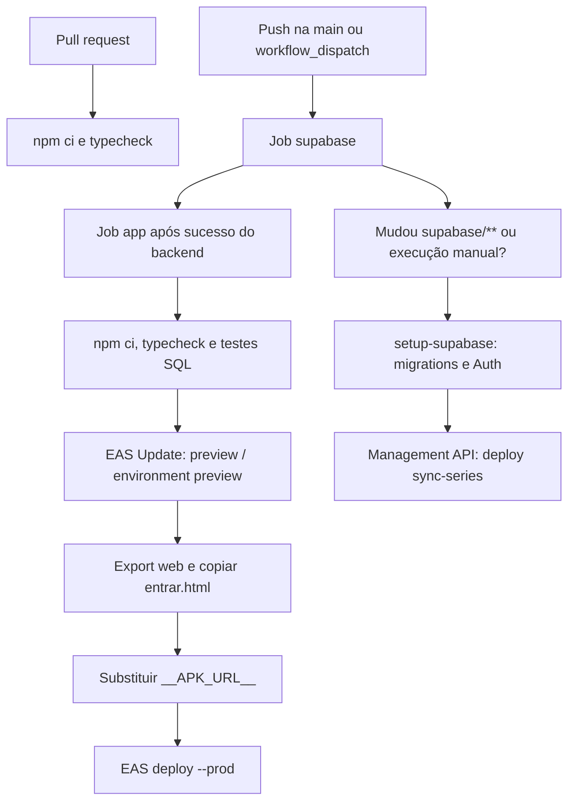

# Infraestrutura, configuração e operação

## Inventário e localização

| Recurso | Identificador/configuração | Evidência em 16/10/2026 |
|---|---|---|
| Repositório | `yurilopesmdv/fi-guesses`; origin SSH `git@github-pessoal:...` | Configuração Git local; alias depende do SSH da máquina |
| Web | `https://bolao-f1.expo.app` — EAS Hosting | HTTP 200 |
| Convite | `https://bolao-f1.expo.app/entrar.html?c=CODIGO` | Página HTTP 200 e sem placeholder APK pendente |
| Supabase | ref `tqbftaqkqtjouovyvrkq`; `https://tqbftaqkqtjouovyvrkq.supabase.co` | Auth e Management API validados; região `sa-east-1` |
| Expo/EAS | owner `yurilopesmdv`; slug `bolao-f1`; project ID `7efe543a-c812-4af7-9e7b-bc998f3b2f4c` | Conta validada; publicações em [relatório](VALIDACAO_PRODUCAO.md) |
| OTA | `https://u.expo.dev/7efe543a-c812-4af7-9e7b-bc998f3b2f4c`, canal `preview` | `app.json`, `eas.json`, workflow; versão instalada não confirmada |
| APK | `https://tqbftaqkqtjouovyvrkq.supabase.co/storage/v1/object/public/site/bolao-f1.apk` | HEAD HTTP 200; conteúdo/assinatura do binário não inspecionados |
| Identidade nativa | `br.com.lopes.bolaof1` (Android e iOS), scheme `bolaof1` | `app.json` |
| Sincronização | `/functions/v1/sync-series` no Supabase | Versão 8 ACTIVE, JWT habilitado, CORS e sincronização real validados |
| Agendamento | `sync-series-hourly`, expressão `5 * * * *` | Migration `0010`; existência e execuções reais não confirmadas |

O cliente roda no aparelho/navegador; a SPA é hospedada no EAS, o banco/Auth/Storage/Edge Function no Supabase e o CI em runners `ubuntu-latest` do GitHub. Não há VPC, servidor próprio, Terraform, Docker, região de nuvem ou infraestrutura AWS declarados. Região do Supabase, plano contratado, custos, cotas, backups disponíveis e retenções não puderam ser confirmados. Os diretórios locais de ferramenta não comprovam hospedagem AWS.

## Variáveis e credenciais

| Nome | Onde é usado | Natureza |
|---|---|---|
| `EXPO_PUBLIC_SUPABASE_URL` | `.env`, Expo, CI/app | Pública; URL do backend compilada no app |
| `EXPO_PUBLIC_SUPABASE_ANON_KEY` | `.env`, Expo, CI/app | Pública por desenho; não substitui autenticação/RLS |
| `EXPO_PUBLIC_LIVE_ENABLED` | `.env`/ambiente EAS e variable GitHub → CI/app | Pública; texto exato `true` habilita o monitor, demais valores desabilitam; padrão `false` |
| `SUPABASE_ACCESS_TOKEN` | `.env` nos scripts; secret do GitHub para setup/deploy | Token administrativo da conta; nunca incorporar ao app |
| `EXPO_TOKEN` | `.env`/shell para EAS, secret do GitHub | Token administrativo de publicação; nunca incorporar ao app |
| `SUPABASE_PROJECT_REF` | Variable do GitHub; argumento do setup no CI | Identificador; default do workflow aponta ao projeto acima |
| `APK_URL` | Variable do GitHub, substituição em `entrar.html` | URL pública; default do workflow é o APK acima |
| `SUPABASE_URL` | Runtime da Edge Function | Fornecida no ambiente da função |
| `SUPABASE_SERVICE_ROLE_KEY` | Runtime da Edge Function; upload busca service role pela Management API | Privilegiada; ignora RLS; não é variável pública do cliente |

Credenciais locais Supabase e Expo foram validadas após atualização pelo usuário. `.env` permanece ignorado e nenhum segredo foi registrado. As variáveis públicas do EAS `preview` conferem com o backend local. Secrets/proteções de branch do GitHub não foram auditados.

Após o levantamento foi incluída a variável opcional `EXPO_PUBLIC_LIVE_ENABLED` no exemplo e no job app do workflow, com fallback `false`. Para habilitar, configurar `true` de forma consistente na variable do GitHub e no ambiente de publicação EAS/local aplicável, depois publicar OTA/web. Para desabilitar novamente, publicar bundle com `false`. É configuração compilada, não leitura de settings a cada abertura. Com a flag desligada, o monitor não autentica nem consulta sessão/telemetria; sincronização F1 e fotos não dependem dessa flag.

`app_settings` também é necessário:

| Chave | Finalidade |
|---|---|
| `functions_url` | URL base `https://REF.supabase.co/functions/v1`; o cron acrescenta `/sync-series` |
| `anon_key` | Bearer que o cron envia à função |
| `openf1_user`, `openf1_pass` | Opcionais: autenticação do cliente no OpenF1 |

As migrations criam a tabela, mas **não populam essas chaves**. O setup não as preenche. O cron depende das duas primeiras. Todas as chaves são legíveis por autenticados; não tratar a tabela como cofre de segredos. Não há confirmação de quais chaves existem no backend atual.

## Pipeline real de publicação



`ci.yml` roda no PR e no push da `main`. `deploy.yml` roda em push na `main` ou manualmente e configura concorrência `deploy-main`, sem cancelar a execução em andamento. O job app depende do sucesso do job Supabase; o filtro inclui `supabase/**`, scripts de migration/deploy, manifests de dependências e o próprio workflow. Quando nenhum desses arquivos muda, esse job termina com os passos de aplicação ignorados. O deploy do app faz seu próprio typecheck e testes SQL, sem depender do workflow CI separado.

O CI e o job app executam TypeScript e os 24 testes de SQL/RLS, handler HTTP e status. Aplicar migrations antes do cliente; `0017`–`0019` já aplicadas no serviço compartilhado. O workflow assegura a dependência app/backend.

Qualquer alteração na `main`, inclusive documentação, dispara o job app. Mudanças apenas em `scripts/setup-supabase.mjs` não satisfazem o filtro `supabase/**`. Execução manual força o job backend. O binário Android não é gerado automaticamente pelo workflow.

Se o banco falhar, o job app é bloqueado. Se o banco passar e os testes/compilação do app falharem, o schema novo permanece com o cliente anterior; mantenha migrations compatíveis. Se OTA passar e Hosting falhar, as plataformas ficam em versões diferentes. Confira os dois jobs. O deploy da função usa `scripts/deploy-function.mjs` e esbuild do lockfile; mantém JWT habilitado. A mensagem do update chega ao comando por variável de ambiente com quoting.

## Migrations e preparação de backend

O comando abaixo altera o projeto indicado:

```bash
npm run db:migrate -- REF_DO_PROJETO
```

`scripts/setup-supabase.mjs` lista projetos acessíveis, seleciona por argumento/ref/nome (ou único projeto), cria `public._migrations`, ordena os arquivos e executa cada migration pendente em transação própria junto do registro de aplicação. Não verifica checksum de migrations já registradas e não tem trava global entre execuções.

Depois das migrations, o mesmo script habilita e-mail e **desliga confirmação de e-mail**, consulta a chave anon e, fora de `CI`, regrava URL/chave pública no `.env`. Não é um comando exclusivamente de schema. Se uma migration falhar, ela é revertida na própria transação; migrations anteriores concluídas permanecem aplicadas. A próxima execução retoma por nome registrado.

Para um projeto novo, a sequência deduzida do código é: criar projeto Supabase na conta → configurar token → rodar setup apontando explicitamente ao ref → preencher `functions_url`/`anon_key` por canal administrativo → publicar `sync-series` → importar dados → configurar GitHub/EAS e realizar distribuição. Bucket `site` é criado pelo upload do APK. Esse provisionamento completo não foi executado nem validado em projeto limpo no levantamento. Não há IaC que reproduza a conta inteira.

Publicação manual da função, com token válido:

```bash
node scripts/deploy-function.mjs sync-series REF_DO_PROJETO
```

Não substitua o runner existente por `supabase db push` sem reconciliar o histórico próprio `_migrations`. Para evolução, crie migration nova. Não existe mecanismo de down migrations.

## Atualizar app, web e APK

OTA de JS compatível:

```bash
npm run publish -- --message "descrição da alteração"
```

`preview` é o canal de uso da família, apesar do nome. No APK, `useOtaUpdate` verifica, baixa e recarrega a atualização ao abrir; falhas de rede são ignoradas e a versão existente continua. O Expo Go tem seu próprio ciclo de carregamento. O projeto define runtime por SDK, atualmente `exposdk:58.0.0` nos links de convite. O Expo Go dos iPhones precisa ser compatível com SDK 58. O APK existente em SDK 57 permanece no runtime anterior e não recebe bundles do SDK 58; migrá-lo exige gerar e distribuir outro APK.

`scripts/eas.mjs` carrega o token do `.env`, com precedência das variáveis do processo. O comando `npm run web:deploy` exporta a SPA, prepara convite/link APK e publica. Para revisar um artefato antes de publicar:

```bash
npx expo export --platform web --output-dir web-build
node scripts/prepare-web.mjs web-build
node scripts/eas.mjs deploy --prod --export-dir web-build --non-interactive
```

Use diretório relativo para o EAS Hosting. `APK_URL` pode substituir a URL pública padrão durante a preparação. O script usa serialização JSON para inserir o valor no HTML; CI e publicação manual compartilham esse procedimento. Para publicar OTA, `npm run publish -- --non-interactive --message "descrição"`. Compile com `EXPO_PUBLIC_LIVE_ENABLED=false` para manter o monitor desligado.

Alterações nativas requerem binário:

```bash
npx eas-cli build -p android --profile preview
# Baixar o APK resultante para um arquivo local; depois:
node scripts/upload-apk.mjs /caminho/arquivo.apk
```

O plugin gera apenas `arm64-v8a`; aparelhos Android de outras arquiteturas não são atendidos por esse APK. O upload busca service role em memória, cria bucket público `site` se necessário e sobrescreve `site/bolao-f1.apk`. Não há versionamento/backup de APK no script: preservar artefato anterior antes da substituição. Credenciais de assinatura ficam sob gestão da conta EAS, sem material versionado no projeto.

## Sincronização e inspeção

A migration agenda a função no minuto **05 de cada hora**. O cron entrega um POST com `{ "series": "all" }`, usando URL e anon de `app_settings`. O relógio/fuso efetivo do serviço deve ser conferido no backend; a agenda se repete de hora em hora. Não há rotina de virada anual além de usar o ano atual no código.

O botão Atualizar aciona `sync-series` para a categoria selecionada; a função aceita também `season` no corpo. A chamada altera dados e pode apurar bolões. Importações por scripts administrativos também escrevem; a importação direta de F1 pelo script/cliente não chama `auto_settle_podiums` explicitamente. A apuração automática acontece no fluxo da Edge Function ou quando o RPC é executado.

Consultas administrativas para diagnosticar, com credencial válida e sem selecionar dados pessoais ou valores de settings:

```sql
select name, applied_at from public._migrations order by name;
select series, season, last_round_with_results, synced_at
from public.f1_sync order by season desc, series;
select key from public.app_settings order by key;
select jobid, jobname, schedule, active from cron.job;
select jobid, status, start_time, end_time
from cron.job_run_details order by start_time desc limit 20;
select proname from pg_proc p join pg_namespace n on n.oid=p.pronamespace
where n.nspname='public' and proname in
('driver_profile','team_profile','team_head_to_head','auto_settle_podiums');
```

`npm run db:sql -- "select ..."` envia SQL via Management API; não restringe comandos a leitura. Não usar o setup como health check. Execução bem-sucedida de `pg_cron`/`pg_net` não comprova que todas as categorias sincronizaram: confira resposta HTTP, logs da função e frescor do `f1_sync`. O handler agora sinaliza falha parcial e falha de apuração; conferir também o corpo.

## Falhas e recuperação

| Sintoma | Verificação e procedimento |
|---|---|
| Expo falha com `parseEnv` | Conferir `node --version`; selecionar Node compatível, validado com 20.19.5 |
| Management API retorna 401 | Validar/substituir `SUPABASE_ACCESS_TOKEN` por canal seguro; confirmar permissões e projeto; não gravar token nos logs |
| Calendário/classificação vazios | Conferir categoria/ano, sessão, RLS, `f1_sync` e erros do importador/fonte; histórico pode ainda não ter sido importado |
| Ranking sem apuração | Conferir três resultados oficiais top 3, data da corrida, perguntas e execução da função/RPC; extras precisam do organizador |
| Resultado esportivo corrigido não altera ranking | Apuração automática não sobrescreve; organizador precisa revisar/salvar a apuração |
| Cron não atualiza | Conferir extensão, job ativo, settings necessários, autenticação da função e logs; não imprimir values de settings |
| Atualizar retorna sucesso com dados antigos | Inspecionar erros por categoria no corpo e logs; `ok` isoladamente não basta |
| Convite não baixa APK | Procurar `__APK_URL__` no HTML publicado e verificar o objeto público |
| Convite/Expo Go falha | Conferir código, scheme, SDK/runtime/canal do link e compatibilidade do Expo Go instalado; usar web como acesso alternativo |
| Usuário fica em loading sem sessão | Conferir rota direta e autenticação; nem todas as rotas têm guard central |
| Ao vivo dá erro/429 | Conferir estado da sessão, rede, assinatura/token e volume de chamadas; o monitor depende de serviço externo |

Para regressão de JS/web, o procedimento disponível pelo repositório é restaurar o código compatível conhecido e republicar no mesmo destino. Para binário, redistribuir APK anterior preservado e compatível com o runtime/canal. Não foi testado rollback nesta investigação.

Para schema, usar migration corretiva compatível; não apagar linhas de `_migrations` para forçar reaplicação. Restauração de banco exige verificar previamente a capacidade real de backup/restore da conta e preservar dados de usuários. Não há procedimento de restauração testado, retenção declarada, RPO/RTO definido, alertas ou monitoramento externo configurados no repositório. Resultados esportivos podem ser reimportados; perfis, membros, palpites e apurações manuais precisam de backup próprio.

## Estado validado em 16/10/2026

Migrations até `0019` registradas, função versão 8 ativa com JWT e cron com timeout de 120000 ms. Respostas recentes do cron: HTTP 200 sem timeout, corpo `ok: true`. Sincronização manual F1/F2/F3 concluída. Publicações e testes reais em [VALIDACAO_PRODUCAO.md](VALIDACAO_PRODUCAO.md). Nenhum APK novo foi gerado para estas alterações JavaScript.

## Acervo de pistas

Após a correção solicitada em 29/10/2026, o catálogo usa somente os 23 traçados oficiais do domínio media.formula1.com. `data/circuits/official-maps.json` contém as URLs e dimensões verificadas (1920×1080 a 3840×2160), autoria Formula 1 e direitos reservados, sem atribuir licença aberta. Os arquivos são exibidos diretamente da origem, sem copiá-los para o Storage.

A migration 0022 despublica fotografias e mapas anteriores. O importador agora exige exatamente um mapa oficial por pista e rejeita galerias. `prepared-media.json` e o bundle de 2026 contêm apenas os mapas oficiais; o upload não envia URLs externas. Para atualizar dados de pista: validar URLs/dimensões em `official-maps.json`, copiar os metadados para `prepared-media.json`, executar `sync-circuits.mjs 2026 --metadata-only` e então `--apply`. Não usar o preparador antigo de fotos: ele interrompe quando o manifesto usa entrega pela origem oficial. Fotografias antigas não são retornadas pelo catálogo nem usadas pela interface.


### Book de trechos F1 (29/10/2026)

A pedido do usuário, o book retorna com nova curadoria: somente trechos do traçado F1 de fontes oficiais, com carros exclusivamente F1 quando presentes. A migration 0022 e a remoção das fotos rejeitadas continuam válidas. Aplicar a nova 0023, então validar `node scripts/sync-circuit-book.mjs` e publicar com `--apply` após código validado e enviado ao GitHub. A transação mantém mapas e estatísticas, despublica fotos anteriores e publica somente o manifesto revisado. Não executar a importação antiga de fotografias. O manifesto esportivo de mapas permanece independente.
